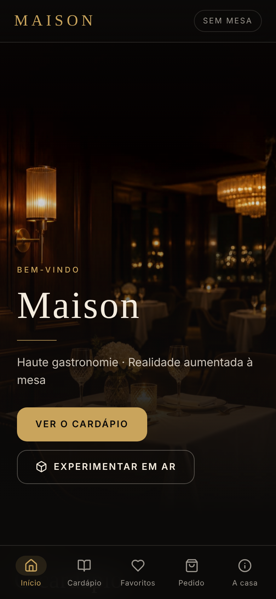
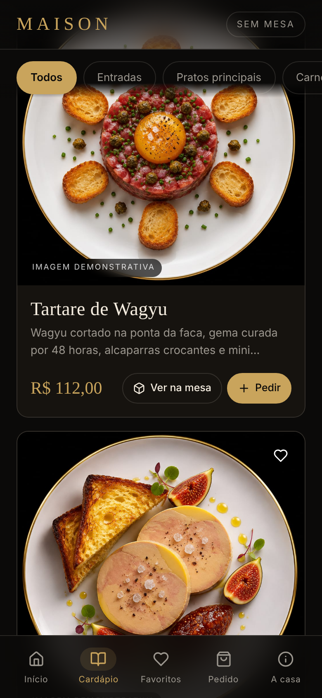
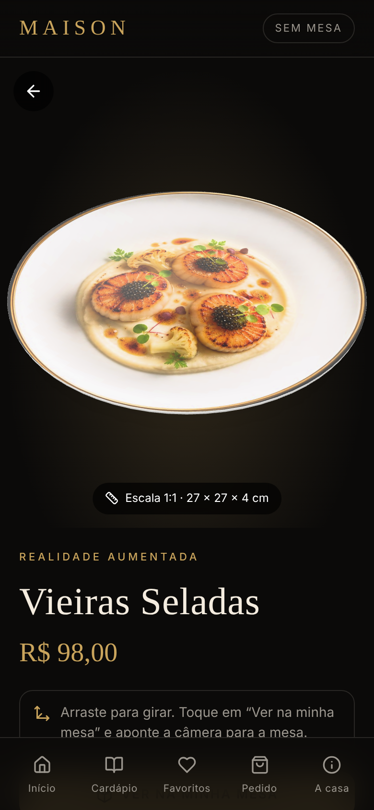

# Maison Premium AR

Plataforma **white-label** de cardápios interativos com **realidade aumentada espacial em escala real** para restaurantes, hotéis, cafeterias e hamburguerias.

- **App do cliente** — início, cardápio com categorias e busca, página do prato, favoritos, AR, carrinho, pedidos vinculados à mesa por QR Code, chamar garçom, pedir a conta, informações da casa.
- **Painel administrativo** — login, múltiplos restaurantes, identidade visual, categorias, produtos, fotos e modelos 3D, dimensões, preços e disponibilidade, mesas e QR Codes, pedidos em tempo quase real, indicadores e relatório CSV.
- **AR** — modelos GLB nas dimensões físicas cadastradas, exibidos por WebXR / Scene Viewer (Android, ARCore) e AR Quick Look (iOS, ARKit).

| | |
|---|---|
|  |  |
|  |  |

Todas as imagens em `docs/screenshots/` são **capturas reais** do aplicativo em execução, geradas por `npm run e2e`.

## Começar

```bash
npm install
npm run dev        # http://localhost:5173
npm test           # 50 testes unitários
npm run build && npm run e2e   # 32 verificações funcionais + capturas
```

Rotas: `#/r/maison` (cardápio), `#/r/brasa` (segundo restaurante), `#/admin` (painel).

## Dois modos de dados

| Modo | Quando | Persistência |
|---|---|---|
| **Demonstração** | sem variáveis `VITE_SUPABASE_*` | no navegador (localStorage). Bom para apresentar; pedidos não trafegam entre aparelhos. |
| **Produção** | com `VITE_SUPABASE_URL` e `VITE_SUPABASE_ANON_KEY` | Postgres + Auth + Storage do Supabase, isolamento por RLS. |

Contas do modo demonstração: `admin@maison.demo` / `maison2026` (plataforma) e `gerente@brasa.demo` / `brasa2026` (só a Brasa & Co.).

## Documentação

- [Instalação e publicação](docs/INSTALACAO.md)
- [Operação do restaurante](docs/OPERACAO.md)
- [Realidade aumentada: tecnologia, cadastro e limitações](docs/AR.md)
- [Comercialização](docs/COMERCIALIZACAO.md)

## Imagens demonstrativas

As fotografias em `public/demo/` foram **geradas por IA** para o restaurante fictício e estão identificadas como "Imagem demonstrativa" no app. Em cada restaurante contratante são substituídas pelas fotos reais dos pratos. Não envie segredos nem fotos privadas a este repositório público.
